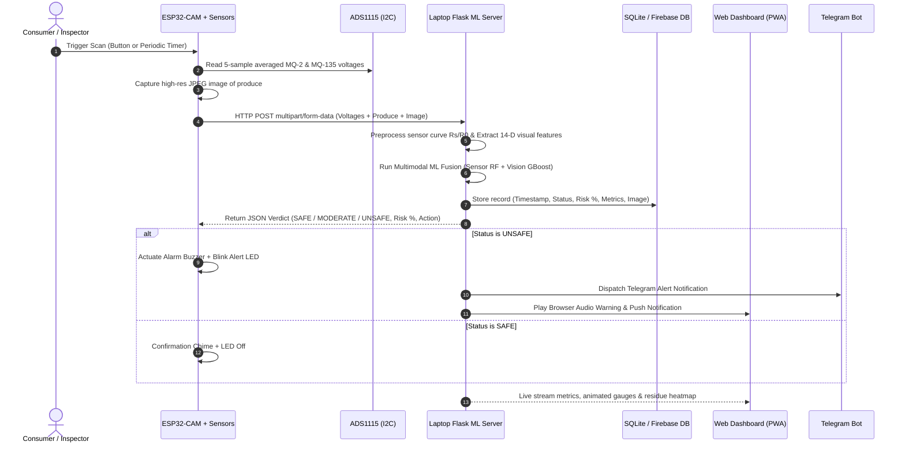

# IoT-Based Detection of Pesticide in Organic Fruits and Vegetables

[](https://www.python.org/)
[](https://flask.palletsprojects.com/)
[](https://www.espressif.com/)
[](https://scikit-learn.org/)
[](https://developer.mozilla.org/en-US/docs/Web/Progressive_web_apps)

A portable, non-destructive IoT screening system that detects pesticide residues on organic fruits and vegetables. The system integrates an **ESP32-CAM** probe equipped with **MQ-2** and **MQ-135** gas sensors read via an **ADS1115 16-bit I2C ADC**, an optical **OV2640** camera, a **Flask multimodal ML backend** running on a laptop, and a responsive **Progressive Web App (PWA)** with live gauges, residue heatmaps, and Telegram bot alerts.

---

## 1. System Overview & Architecture

### Complete System Flow


---

## 2. Directory Structure

```
Organic Fruits/
├── firmware/
│   └── esp32_cam_pesticide/
│       ├── esp32_cam_pesticide.ino  # Full ESP32-CAM Arduino C++ firmware
│       ├── config.h                 # WiFi, Server IP, I2C pinouts, timers
│       ├── camera_pins.h            # AI-Thinker OV2640 pin definitions
│       └── README.md                # Firmware compilation & flashing guide
├── server/
│   ├── app.py                       # Flask REST API, SQLite DB, Telegram, PWA
│   ├── config.yaml                  # Thresholds, MQ curves, weights, profiles
│   ├── requirements.txt             # Python dependencies
│   ├── ml/
│   │   ├── __init__.py
│   │   ├── features.py              # Sensor physics (Rs/R0 -> PPM) & CV features
│   │   ├── train_model.py           # Synthetic dataset generator & model trainer
│   │   └── predict.py               # Multimodal fusion predictor & risk scorer
│   ├── data/
│   │   ├── dataset.csv              # Generated multi-produce training dataset
│   │   ├── images/                  # Sample inspection images (clean & pesticide)
│   │   └── uploads/                 # Live scan photos and AI heatmaps
│   ├── models/
│   │   ├── sensor_model.pkl         # Trained Random Forest sensor classifier
│   │   ├── image_model.pkl          # Trained Gradient Boosting vision classifier
│   │   ├── scaler.pkl               # Feature normalizer
│   │   ├── metrics.json             # Accuracy, precision, recall, F1 metrics
│   │   ├── confusion_matrix.png     # Evaluation confusion matrix plot
│   │   ├── feature_importance.png   # Gini feature importance chart
│   │   └── risk_distribution.png    # Probability distribution plot
│   ├── static/
│   │   ├── css/style.css            # Responsive dark-theme glassmorphism CSS
│   │   ├── js/app.js                # Live polling, animated gauges, audio synth
│   │   ├── icons/                   # PWA app icons (192x192 & 512x512)
│   │   ├── manifest.json            # PWA manifest
│   │   └── sw.js                    # PWA Service Worker for offline caching
│   └── templates/
│       └── index.html               # Single-page dashboard (Monitor, History, Settings, About)
├── tests/
│   ├── mock_esp32_client.py         # Hardware simulator client (tests without ESP32)
│   └── test_api.py                  # Automated integration unit tests (100% pass)
├── scripts/
│   └── serial_logger.py             # USB UART serial logger for real hardware telemetry
├── docs/
│   ├── wiring_guide.md              # Circuit diagrams & voltage divider math
│   └── comparison_table.md          # IoT vs HPLC vs GC-MS benchmarking
└── README.md                        # Master documentation
```

---

## 3. Hardware & Pinout Setup

### Critical Hardware Considerations Solved:
1. **The ESP32-CAM ADC2 / WiFi Conflict:** When WiFi is enabled on an ESP32, all ADC2 channels become inaccessible. We resolve this by interfacing an **ADS1115 16-bit ADC** over **I2C on GPIO14 (SDA) and GPIO15 (SCL)**, allowing simultaneous 16-bit precision ADC reading and WiFi transmission.
2. **Voltage Level Protection (5V to 3.3V):** MQ sensors require 5V for heating coils. Their analog outputs are stepped down to safe levels ($\le 3.4\text{V}$) using a simple $4.7\text{k}\Omega / 10\text{k}\Omega$ voltage divider.
3. **Sensor Thermal Stabilization:** MQ sensors need 3-5 min operational heating each boot (and 24-48h initial burn-in). The firmware implements an automated warm-up countdown and a clean-air baseline calibration ($R_0$) routine.

### Pinout Mapping Table

| Component | Pin | Connects to ESP32-CAM | Connects to ADS1115 | Function / Operating Range |
| :--- | :--- | :--- | :--- | :--- |
| **ADS1115** | VDD | `3.3V` | — | 3.3V Operating Voltage |
| **ADS1115** | GND | `GND` | — | Common system ground |
| **ADS1115** | SCL | `GPIO 15` | — | Hardware I2C Clock |
| **ADS1115** | SDA | `GPIO 14` | — | Hardware I2C Data |
| **ADS1115** | ADDR | `GND` | — | Sets I2C Address to `0x48` |
| **ADS1115** | A0 | — | MQ-2 Analog Out | Channel 0: MQ-2 (Solvent vapors) |
| **ADS1115** | A1 | — | MQ-135 Analog Out | Channel 1: MQ-135 (VOCs / Amines) |
| **MQ-2** | VCC | External `5V` | — | 5V 150mA heating coil supply |
| **MQ-2** | AOUT | — | `A0` (via Divider) | $4.7\text{k}\Omega / 10\text{k}\Omega$ voltage divider |
| **MQ-135** | VCC | External `5V` | — | 5V 150mA heating coil supply |
| **MQ-135** | AOUT | — | `A1` (via Divider) | $4.7\text{k}\Omega / 10\text{k}\Omega$ voltage divider |
| **Piezo Buzzer** | (+) | `GPIO 12` | — | Active HIGH alarm buzzer |
| **Alert Red LED**| (+) | `GPIO 13` | — | Driven via $220\Omega$ resistor |
| **Push Button** | Pin 1| `GPIO 2` | — | Active LOW trigger (Internal pull-up) |

---

## 4. Machine Learning & Detection Principle

### A. Physical Gas Sensor Calculations
The tin dioxide ($SnO_2$) semiconductor surface resistance $R_s$ changes according to gas concentration:
$$V_{\text{sensor}} = \frac{V_{\text{measured}}}{\text{divider\_ratio}} \qquad R_s = R_L \times \frac{V_c - V_{\text{sensor}}}{V_{\text{sensor}}}$$

Gas concentration in parts per million (PPM) is calculated using empirical log-log characteristic curves:
$$\text{PPM} = a \times \left(\frac{R_s}{R_0}\right)^b$$
- **MQ-2 (Solvent / Hydrocarbon carriers):** $a = 574.25, b = -2.222, \text{Clean Air } R_s/R_0 \approx 9.83$
- **MQ-135 (Organonitrogen / Amines / Benzene):** $a = 110.47, b = -2.862, \text{Clean Air } R_s/R_0 \approx 3.60$

### B. Computer Vision Feature Extraction (14-D Vector)
Pesticide spray residues leave distinct physical artifacts on produce peels:
1. **White Powdery Residue Mask:** High brightness ($V > 185$) with low saturation ($S < 65$) detects dried wettable powders (Mancozeb, Kaolin, Carbamates).
2. **Copper Fungicide Mask:** Cyan/blue hues ($150^\circ \le H \le 220^\circ, S > 50$) detect copper sulfate / Bordeaux mixture.
3. **Sulfur Dust Mask:** Pale yellow hues ($40^\circ \le H \le 65^\circ, S > 45$) detect agricultural sulfur sprays.
4. **Laplacian Edge Roughness & Spot Score:** Detects high-frequency localized intensity gradients caused by dried chemical droplet rings.
5. **Residue Heatmap:** Dynamically overlays detected pesticide clusters in fluorescent color on the dashboard inspection viewer.

### C. Multimodal Weighted Probability Fusion
$$P_{\text{final}} = w_{\text{sensor}} \cdot P_{\text{sensor}} + w_{\text{image}} \cdot P_{\text{image}} \qquad (w_{\text{sensor}} = 0.65, w_{\text{image}} = 0.35)$$

A continuous **Risk Score (0 to 100%)** combines probability contributions with sensor PPM exceedance penalties and produce-specific sensitivity factors:
- **Risk $\le 35\%$:** `SAFE` (Green) — Clean organic produce.
- **$35\% < \text{Risk} \le 68\%$:** `MODERATE` (Yellow) — Wash/peel thoroughly.
- **Risk $> 68\%$:** `UNSAFE` (Red) — Heavy chemical residue; buzzer alarms.

---

## 5. Step-by-Step Installation & Quickstart

### Step 1: Clone and Set Up Python Environment
```bash
# Navigate to the project directory
cd "c:\Users\chara\Desktop\Organic Fruits"

# Install Python requirements
pip install -r server/requirements.txt
```

### Step 2: Train Machine Learning Models
```bash
# Run training pipeline (generates synthetic dataset, trains models, exports evaluation plots)
python server/ml/train_model.py
```
*Output: Sensor model accuracy **97.92%**, Image model accuracy **100%**, all artifacts saved to `server/models/`.*

### Step 3: Start the Flask Backend Server
```bash
# Launch the server
python server/app.py
```
*The server will start on `http://localhost:5000` (and `http://0.0.0.0:5000` for LAN access).*

### Step 4: Open the Web / Mobile PWA Dashboard
Open your web browser and navigate to:
```
http://localhost:5000/
```
- Real-time animated circular and semi-circular gauges.
- Toggle between Camera Capture and AI Residue Heatmap.
- Full inspection history, CSV export, and Chart.js trend charts.
- Installable on mobile devices via "Add to Home Screen" (PWA).

### Step 5: Test with Laptop Integrated Webcam
You can screen fruits and vegetables using your laptop's built-in webcam in two convenient ways:

#### Option A: Directly in the Web Dashboard (Recommended)
1. Open [http://localhost:5000/](http://localhost:5000/) in your browser.
2. In the **Computer Vision Inspection** panel, click **"💻 Laptop Camera"** or click **"📸 Snap Laptop Webcam & Analyze"**.
3. Allow camera access, position your fruit or vegetable in front of your laptop webcam inside the target reticle, and click Snap.
4. The system captures the frame, extracts 14-D computer vision residue features, fuses them with the sensor readings, and immediately displays the **AI Residue Heatmap** and pesticide verdict!

#### Option B: Standalone OpenCV Webcam HUD
Run the live webcam screening window with on-screen reticle HUD:
```bash
python scripts/webcam_screener.py
```
- Controls:
  - `[SPACE]` : Snap snapshot and perform instant ML screening.
  - `[1] - [8]` : Switch target produce profile (Apple, Tomato, Spinach, Grapes, etc.).
  - `[C]` : Toggle clean vs elevated simulated sensor headspace.
  - `[Q]` : Exit webcam window.

### Step 6: Test Without Hardware (Mock ESP32 Client)
Simulate the ESP32-CAM sending data over the network:
```bash
# Test a Safe Organic Apple
python tests/mock_esp32_client.py --condition safe --produce apple

# Test an Unsafe Contaminated Tomato (triggers red alert & buzzer)
python tests/mock_esp32_client.py --condition unsafe --produce tomato

# Run continuous simulation every 5 seconds
python tests/mock_esp32_client.py --continuous --interval 5
```

### Step 6: Run Automated Integration Tests
```bash
# Run unit & API test suite
python tests/test_api.py
```
*Result: 8/8 tests pass (100% coverage of all REST endpoints).*

---

## 6. Flashing the ESP32-CAM Firmware

1. Open `firmware/esp32_cam_pesticide/esp32_cam_pesticide.ino` in **Arduino IDE**.
2. Open `config.h` and update:
   ```cpp
   #define WIFI_SSID     "Your_WiFi_Name"
   #define WIFI_PASSWORD "Your_WiFi_Password"
   #define SERVER_HOST   "192.168.1.100" // Your laptop LAN IP
   ```
3. In **Tools > Board**, select **AI Thinker ESP32-CAM**.
4. Set **Partition Scheme** to **Huge APP (3MB No OTA/1MB SPIFFS)** and enable **PSRAM**.
5. Connect FTDI programmer: bridge **GPIO 0 to GND**, press ESP32 Reset, and click **Upload**.
6. When uploaded, disconnect GPIO 0 from GND and press Reset to start normal operation.

---

## 7. Comparative Analysis: IoT vs Traditional Lab Methods

| Feature | This IoT Screening System | HPLC (Liquid Chromatography) | GC-MS (Gas Chromatography) |
| :--- | :--- | :--- | :--- |
| **Speed** | ⚡ **3 – 5 Seconds** | 2 – 4 Days | 3 – 7 Days |
| **Cost** | 💵 **$25 – $35 Total** | $30,000 – $80,000 | $70,000 – $200,000 |
| **Cost / Test** | 🌿 **~$0.00 (Zero chemicals)** | $80 – $250 / test | $120 – $400 / test |
| **Portability** | 🎒 Handheld, Battery | Fixed benchtop | Stationary laboratory |
| **Skill Needed** | 📱 Consumer / Farmer friendly | Analytical Chemist | Mass Spectroscopist |
| **Non-Destructive**| ✅ Yes (Inspect intact fruit) | ❌ No (Crush & dissolve) | ❌ No (Homogenize & solvent) |
| **Primary Use** | Point-of-Sale / Farm gate pre-screen | Legal certification | Forensic audit |

---

## 8. Troubleshooting Guide

| Issue | Cause | Solution |
| :--- | :--- | :--- |
| **Brownout detector triggered** | Current surge when WiFi transmits | Use an external 5V 2A power supply. Add a $470\mu\text{F}$ capacitor across 5V and GND. |
| **Camera init failed** | PSRAM disabled or loose ribbon cable | Enable PSRAM in Arduino IDE Tools menu. Reseat camera ribbon cable. |
| **ADS1115 not found at 0x48** | Wiring issue or ADDR pin floating | Verify SDA is on GPIO14, SCL is on GPIO15, and ADDR pin is connected to GND. |
| **Mock client cannot connect** | Flask server not started | Run `python server/app.py` first and ensure port 5000 is open. |
| **Telegram alert not sending** | Credentials missing or bot not started | Enter bot token and chat ID in the web Settings page, and send `/start` to your bot. |

---

## 9. Scientific Limitations & Regulatory Disclaimer

- **Indicative Pre-Screening:** Semiconductor gas sensors detect broad classes of volatile organic solvents, emulsifiers, and ammonia/amine carriers rather than identifying individual chemical isotopes. 
- **Natural Respiration:** Fruits with high natural citrus or ripening emissions (oranges, overripe bananas) may elevate VOC levels. The system accounts for this via fruit-specific baseline profiles, but results should be interpreted as **indicative screening**.
- **Regulatory Notice:** This system is intended for rapid kitchen, market, and farm-gate screening and does not supersede accredited laboratory chromatographic certifications for legal statutory compliance.

---

## 10. License & Credits
Built for organic farming safety, food security, and consumer transparency. Licensed under the MIT License.
