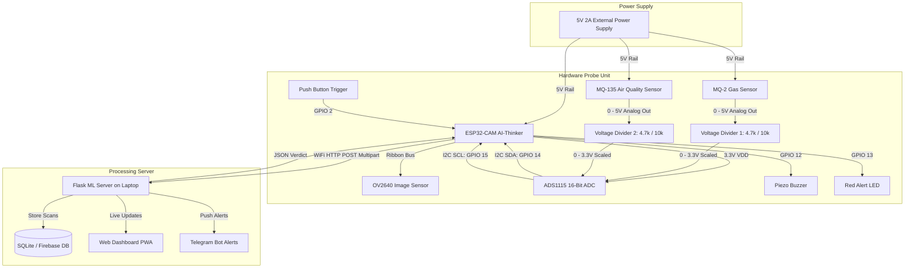

# Hardware Wiring & Circuit Integration Guide

This guide details the physical electrical wiring, voltage level matching, and circuit architecture for the **IoT Pesticide Residue Screening System**.

---

## 1. System Block Diagram (Mermaid)



---

## 2. Pin Mapping Table

| Component | Pin | ESP32-CAM Pin | ADS1115 Pin | Electrical Description |
| :--- | :--- | :--- | :--- | :--- |
| **ADS1115** | VDD | `3.3V` | — | Power from ESP32 internal 3.3V LDO |
| **ADS1115** | GND | `GND` | — | Common system ground |
| **ADS1115** | SCL | `GPIO 15` | — | I2C Bus Clock |
| **ADS1115** | SDA | `GPIO 14` | — | I2C Bus Data |
| **ADS1115** | ADDR | `GND` | — | Tied to GND for I2C Address `0x48` |
| **ADS1115** | A0 | — | MQ-2 Scaled Out | 16-bit analog channel 0 |
| **ADS1115** | A1 | — | MQ-135 Scaled Out | 16-bit analog channel 1 |
| **MQ-2** | VCC | `5V` (External) | — | 5V 150mA heating coil supply |
| **MQ-2** | GND | `GND` | — | Common ground |
| **MQ-2** | AOUT | — | `A0` (via Divider) | High gas = higher voltage |
| **MQ-135** | VCC | `5V` (External) | — | 5V 150mA heating coil supply |
| **MQ-135** | GND | `GND` | — | Common ground |
| **MQ-135** | AOUT | — | `A1` (via Divider) | High VOCs = higher voltage |
| **Piezo Buzzer** | Anode (+) | `GPIO 12` | — | Active HIGH alarm output |
| **Piezo Buzzer** | Cathode (-)| `GND` | — | Common ground |
| **Alert LED** | Anode (+) | `GPIO 13` | — | Driven through $220\Omega$ resistor |
| **Alert LED** | Cathode (-)| `GND` | — | Common ground |
| **Push Button** | Terminal 1| `GPIO 2` | — | Active LOW input (Internal pull-up) |
| **Push Button** | Terminal 2| `GND` | — | Ground on button press |

---

## 3. Voltage Divider Calculation

The MQ-2 and MQ-135 gas sensor boards output analog voltages in the range of **0.1V to 5.0V**. Feeding this directly into a 3.3V ADC would cause saturation and potentially damage the ADC.

A 2-resistor voltage divider is placed on each analog signal:

```
MQ Analog Out (0 - 5V)
       │
      ┌┴┐
      │ │ R1 (4.7 kΩ)
      └┬┘
       ├───> Scaled Voltage to ADS1115 (0 - 3.4V max)
      ┌┴┐
      │ │ R2 (10.0 kΩ)
      └┬┘
       │
      GND
```

$$\text{Divider Ratio} = \frac{R_2}{R_1 + R_2} = \frac{10,000}{4,700 + 10,000} = 0.680$$

$$\text{Max Voltage at ADS1115} = 5.0\text{V} \times 0.680 = 3.40\text{V}$$

In the Python backend (`server/config.yaml`), `voltage_divider_ratio: 0.66` is applied to accurately reconstruct the true sensor resistance $R_s$:

$$V_{\text{actual}} = \frac{V_{\text{measured}}}{\text{divider\_ratio}}$$
$$R_s = R_L \times \frac{V_c - V_{\text{actual}}}{V_{\text{actual}}}$$

---

## 4. Power & Decoupling Recommendations

1. **Power Budget:**
   - ESP32-CAM peak RF transmit current: ~250–350 mA.
   - MQ-2 heating coil: ~150 mA.
   - MQ-135 heating coil: ~150 mA.
   - **Total minimum supply required:** **5V at 1.5A to 2.0A**. Powering directly from a laptop USB 2.0 port (500mA limit) will trigger brownout restarts. Use a dedicated 5V 2A USB wall adapter.
2. **Decoupling Capacitor:**
   - Solder a $470\mu\text{F}$ or $1000\mu\text{F}$ 10V electrolytic capacitor directly across the ESP32-CAM `5V` and `GND` pins to buffer transient current spikes when the WiFi radio fires and the camera captures simultaneously.
